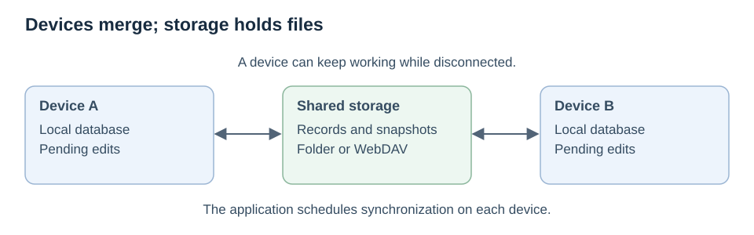

# day-sync

An app used on several devices needs to keep working when some are offline. Changes may arrive
late or more than once, two devices may edit the same item, and a connection can fail halfway
through an upload. Keeping every change forever also makes synchronization increasingly costly.

**day-sync is an experimental Rust library for synchronizing a
[day-persistence](https://github.com/daybrite/day-persistence) store through shared file storage.**
Each device keeps its own database and exchanges changes through a folder or WebDAV collection.
The devices perform the merging; the storage service does not need to understand the app's data.



## How synchronization works

A local edit and the record needed to synchronize it are saved together. The app can keep
working offline and send those records later. When it syncs, day-sync checks incoming data,
combines it with local changes, and publishes outstanding work. Repeated delivery is safe,
and interrupted work can resume from durable local records.

Changes carry enough history to distinguish an edit that replaces an earlier value from two
edits made independently. Concurrent versions are preserved and resolved using a consistent
rule, which the application can customize. Devices converge when they receive the same valid
data and use the same application rules.

To keep history manageable, a device can publish a **snapshot** of the replicated state,
including concurrent versions and the information needed to preserve deletions. It reads back
and verifies the complete snapshot before removing older inputs it has individually processed.
This cleanup does not require every device to be online. A returning device can catch up from
snapshots and newer changes without replaying the entire history. Large offline backlogs can
also be published directly as a snapshot.

Synchronization may take several passes: cleanup and catch-up are bounded, and the library
reports remaining work. The application controls when to sync and retry.

## What the workspace provides

| Crate | Purpose |
|---|---|
| `day-sync` | Replication, conflict handling, snapshots, recovery, and an in-memory test store. |
| `day-sync-webdav` | Shared storage through WebDAV, using Day's native HTTP support or `reqwest`. |
| `day-sync-filesystem` | Shared storage through a filesystem directory. |

Applications supply an adapter for their data and conflict rules. Additional storage backends
can implement the same small storage interface.

## Scope and limitations

This is **experimental protocol v5**, not a production release. Older protocol formats require
fresh v5 stores; there is no automatic migration.

- The storage service and its writers are trusted. Data is plaintext at the protocol layer;
  checksums detect corruption but do not authenticate authors. WebDAV should use HTTPS and
  the service's authentication.
- Snapshots preserve current replicated state, not a permanent edit history. Sync is not a
  backup, and restoring an old database requires a fresh device identity.
- Device counts and state sizes have limits. Safe cleanup needs temporary room for a complete
  replacement; deletion markers and concurrent versions still occupy space.
- The current adapter uses whole, bookmark-shaped records. Field-level collaborative editing,
  attachments, partial sync, and browser execution are outside this prototype's scope.

## Read more and try it

- [How synchronization works](docs/synchronization.md), with illustrated scenarios.
- [Protocol and integration reference](docs/protocol-reference.md), including limits and recovery.

The [development instructions](docs/protocol-reference.md#development) cover dependencies and
checks. Run the disposable example from the repository root:

```sh
cargo run -p day-sync --example compaction
```

Licensed under [MPL-2.0](LICENSE).
