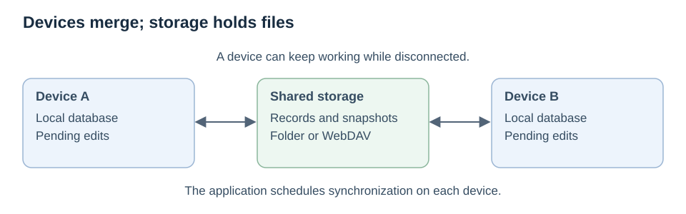
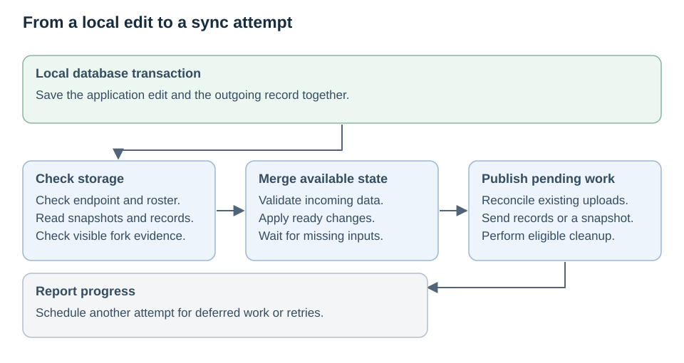
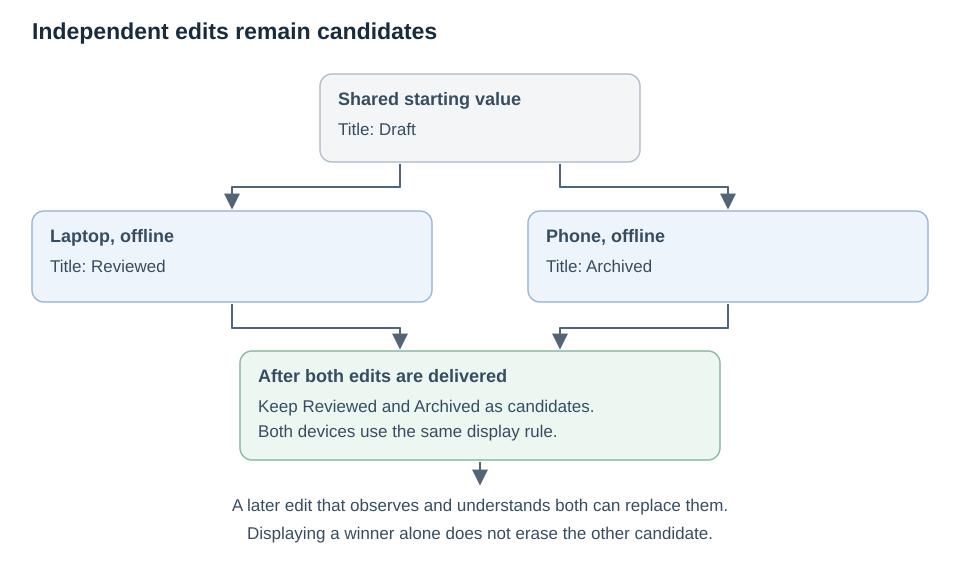
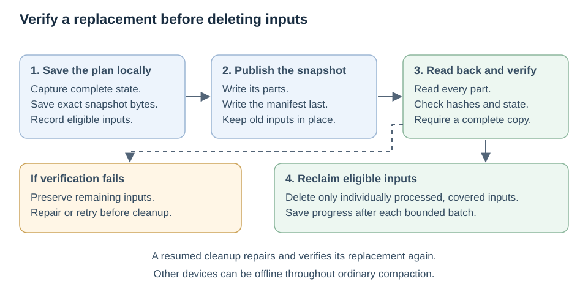
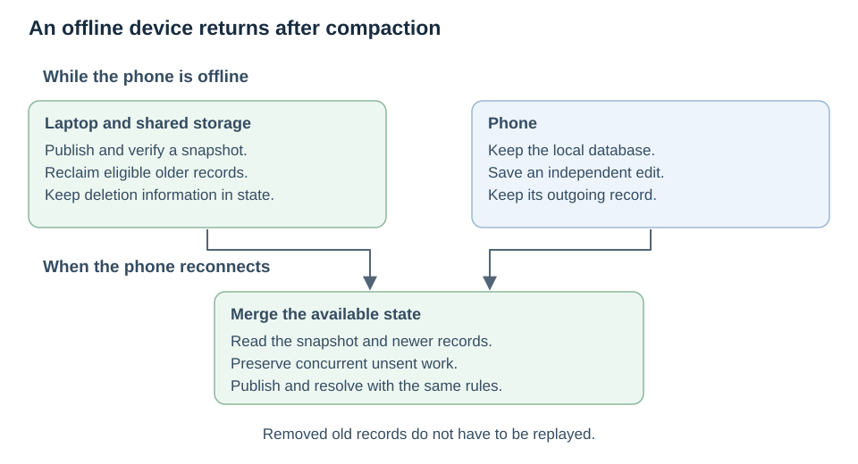
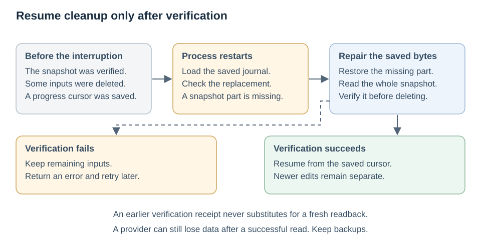

<!--
Copyright © The Daybrite Project
SPDX-License-Identifier: MPL-2.0
-->

# How synchronization works

An app on several devices needs to preserve edits while devices are offline, combine changes
made independently, and recover when a connection fails. It also needs to limit the history
that every device must download and keep.

Day-sync addresses these problems by exchanging changes and snapshots through shared storage.
Each device keeps a local database. The storage service holds files; the devices validate and
merge their contents. A WebDAV collection or a filesystem directory can supply that storage.

This is an experimental protocol for trusted devices and storage. The
[protocol reference](protocol-reference.md) covers integration, limits, and error handling.

## An edit starts on the device

The application saves an edit and its synchronization record in the same database transaction.
An edit that commits therefore has a durable record to send later. The app can keep working
without a connection, subject to the database's capacity and lifecycle restrictions.

A sync attempt checks the shared storage, brings in available changes, and publishes pending
local work. A change carries its device identity, sequence, and the history that device had
observed. These let the receiver recognize repeated delivery and distinguish a later edit from
an independent one. Missing prerequisites wait for delivery; unrelated valid work can continue.

The diagram shows the main stages. Large incoming backlogs can trigger snapshot publication and
cleanup during catch-up. A successful call may leave work for another pass. The application
schedules those calls and handles transport failures; day-sync does not run a background scheduler.

## Two devices edit the same item

Suppose a laptop and a phone both start with the title “Draft.” While disconnected, the laptop
changes it to “Reviewed” and the phone changes it to “Archived.” Neither edit observed the other,
so day-sync retains both as *candidates*: versions that have not been replaced by a later,
observing edit.

The application chooses which candidate to display through a deterministic conflict rule.
The default rule gives a concurrent deletion priority. For concurrent values, it uses a logical
counter and device identity, rather than wall-clock time. Applications can supply a different rule.

Keeping a candidate is different from showing it. Choosing a displayed value does not erase
its concurrent alternative. A later edit can replace the candidates it observed and understood.
Devices converge when they receive the same valid state and use the same application rules.

## Snapshots replace accumulated history

Replaying every edit becomes expensive as history grows. A **snapshot** records the complete
replicated state known to its writer: surviving candidates, deletion information, revision
metadata, and the position reached in each device's history. Superseded edits can then be removed.

The writer first saves the snapshot and its exact cleanup list locally. It uploads the snapshot
parts, publishes the manifest that describes them, and reads back the complete result. Only after
verification may it delete eligible inputs. An eligible input is an individually processed record
or verified older snapshot that the replacement covers. Seeing a filename or a covered sequence
number alone does not make an input eligible.

Cleanup takes bounded steps and saves its progress. On every resumed cleanup attempt, the writer
repairs and fully verifies the replacement again before deleting more inputs. Another device does
not need to be online or acknowledge ordinary compaction.

A large unpublished outbox can go directly into a snapshot. This avoids uploading many temporary
records just to delete them. Storage must still have room for the replacement alongside existing
inputs. If it does not, the operation fails and preserves the inputs. Snapshots exceeding the
local size budget cannot compact that state; ordinary records may still synchronize.

## A device returns after being offline

A returning device can load a snapshot and the changes that follow it instead of replaying all
removed records. It merges that state with its local work. Edits it made independently while
offline still participate in conflict resolution.

Deletion information remains in snapshots so an older value does not reappear merely because
an offline device returns. A restored database is a different case: reusing an old writer identity
can conflict with history that identity already published. Restore through recovery with a fresh
identity rather than continuing the old writer.

An intact local replica can repair some missing remote history. It can republish applied state
or resume a saved snapshot. It cannot invent a missing change that it never applied, and a fresh
device cannot detect history that the storage service hides completely.

## A sync attempt is interrupted

A lost response does not establish whether an upload succeeded. On retry, day-sync checks the
persisted object's bytes before deciding whether it must upload or repair them. A snapshot's
manifest and parts must all verify before the snapshot can authorize deletion.

If the process stops during cleanup, the saved snapshot and progress cursor allow a later
attempt to resume. If the replacement has lost a part, the writer repairs it before continuing.
Edits made after snapshot capture remain separate pending work.

Verification establishes what was readable at that moment. It cannot make a provider retain
those bytes afterward. Periodic audits check known snapshots; missing listed parts are
investigated immediately. Recovery still depends on a surviving copy of the required state.

## Boundaries of the design

- **Storage and writers are trusted.** Protocol data is plaintext. Hashes detect corruption and
  conflicting evidence, but do not authenticate authors. WebDAV should use HTTPS and the
  storage service's authentication.
- **Compaction preserves current state, not an edit archive.** Concurrent candidates and deletion
  markers remain; superseded operations do not. Keep independent backups for historical recovery.
- **Resources are finite.** Snapshots, records, listings, and device counts have limits. Large
  states and long backlogs can require several calls or exceed those limits.
- **The application defines meaning.** The prototype carries whole URL/title values through an
  application adapter. It does not provide field-level editing, attachments, or partial sync.
- **Availability matters.** Convergence requires eventual access to surviving valid data. Same-name
  corruption can remain undetected until an audit, and older compacted history provides less
  evidence for detecting a cloned writer.

For a runnable scenario covering offline edits, deletion, compaction, and restart repair, run
`cargo run -p day-sync --example compaction` from the repository root. The
[reference](protocol-reference.md#development) lists the development setup and checks.
